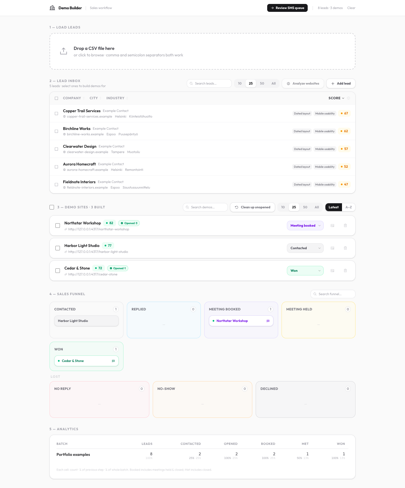
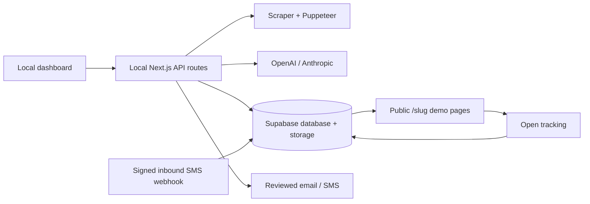
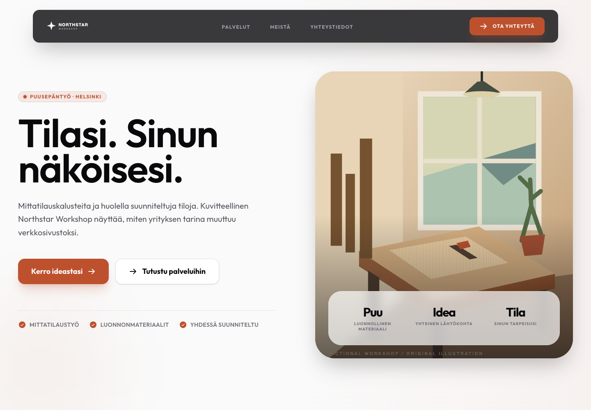
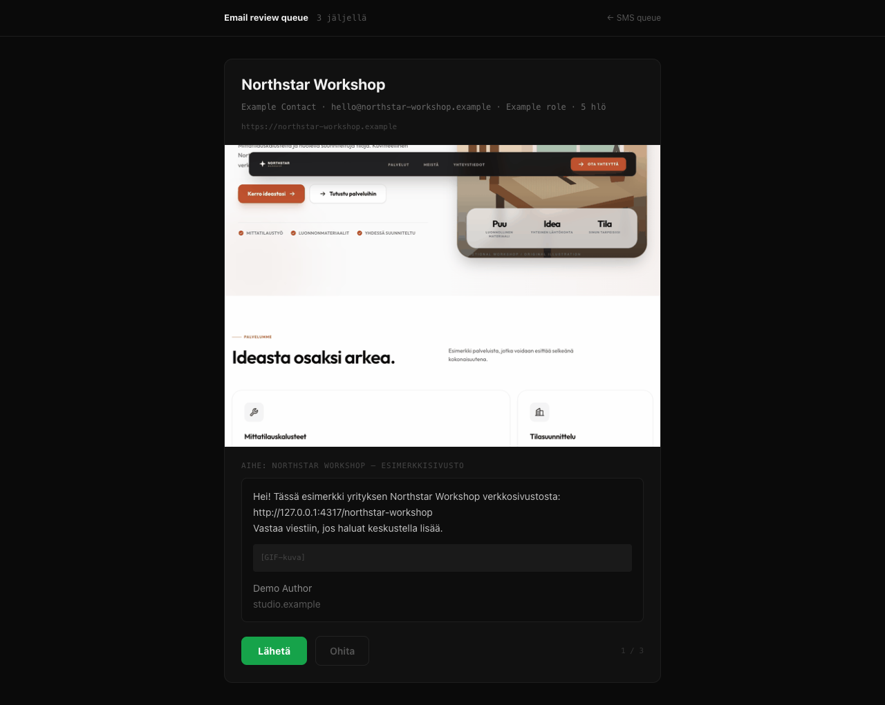

# AI Website Generator

[](https://github.com/rasmussorri/ai-website-generator/actions/workflows/ci.yml)

A full-stack tool that turns an existing business website into a personalized redesign demo and manages the follow-up workflow.

Built with **Next.js, React, TypeScript, Supabase, OpenAI/Anthropic, Puppeteer, Resend, and Twilio**. This is a sanitized portfolio edition of a private operational project. All included businesses, contacts, artwork, and screenshots are fictional.



## What it does

- **Prioritizes prospects:** imports CSV batches, inspects websites, and combines HTML signals with optional screenshot-based AI analysis to score redesign opportunities.
- **Generates demo websites:** scrapes existing content and image candidates, writes structured copy, selects imagery, and stores a complete demo in Supabase. Progress streams to the dashboard over server-sent events.
- **Publishes without a rebuild:** a dynamic slug route renders the saved content, with on-demand cache invalidation for changes.
- **Supports reviewed outreach:** email and SMS queues, animated site previews, suppression lists, audit records, and a two-way SMS inbox.
- **Tracks the workflow:** funnel stages, demo opens, per-batch analytics, and scheduled cleanup of unopened demos.

The workflow is built around Finnish businesses; generated copy follows the source language and phone normalization targets Finnish numbers. UI labels currently mix English and Finnish.

## Architecture



The **dashboard and administrative API routes run locally**. Vercel exposes demo pages and four narrowly scoped endpoints: cache revalidation, inbound SMS, open tracking, and scheduled cleanup. The dashboard has no hosted user-authentication layer; the supplied deployment middleware blocks it on Vercel. The local server binds to loopback by default. Supabase's service-role credential is used only on the server.

This is a workspace tool, not a tenant-isolated SaaS platform. Each independent installation should use its own service accounts and database.

## Preview

| Generated website | Email review queue |
| --- | --- |
|  |  |

Screenshots come from the real application using an isolated fixture backend. They do not show production records or demonstrate real conversion results. Fixture artwork is original SVG; no client assets or signatures are included.

## Run it

Requires **Node.js 24**, npm, and your own Supabase project. At least one AI provider key is needed for live generation/analysis. OpenAI enables optional visual image selection and the standalone signature script. Email, SMS, and public deployment are optional integrations.

```bash
git clone https://github.com/rasmussorri/ai-website-generator.git
cd ai-website-generator
nvm use
cd demo-builder
npm ci
cp .env.example .env.local
# Fill in your own Supabase and AI configuration.
npm run migrate
npm run dev
```

Open [the local dashboard](http://localhost:3000/dashboard). See [SETUP.md](SETUP.md) for the database, deployment, and optional integrations.

There is no offline product mode. The [examples](examples/README.md) document the CSV and generated-content formats; their reserved `.example` URLs are intentionally not live scraping targets.

## Development

```bash
cd demo-builder
npm run lint
npm run typecheck
npm run build
```

CI runs these checks with placeholder configuration and no production service connections. The fixture-based browser check is available as `npm run verify:portfolio`; it uses a temporary loopback backend, not your `.env.local`. See [verification notes](docs/VERIFICATION.md).

The application is under `demo-builder/`; schema migrations are under its `supabase/migrations/` directory. Migration numbers retain their original order; deployment-specific data rewrites were removed. Customer scrape output and generated assets are ignored by Git. Updates use normal Git commands; there is no in-app updater or automatic deployment control.

## CV description

Built an AI-assisted website generation and sales-workflow tool with Next.js, TypeScript, and Supabase, integrating website scraping, multimodal analysis, streamed generation, reviewed email/SMS outreach, and engagement tracking.

## License

[MIT](LICENSE) © 2026 Rasmus Sorri. Third-party dependencies retain their respective licenses.
